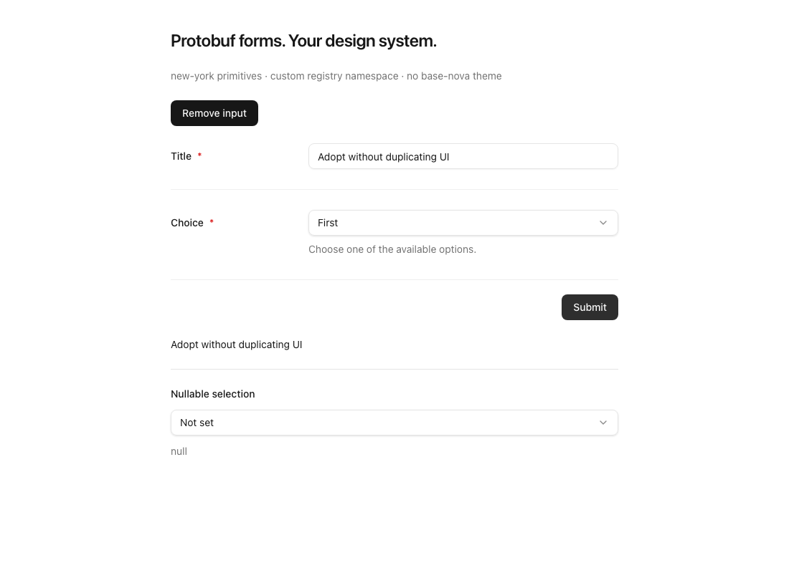
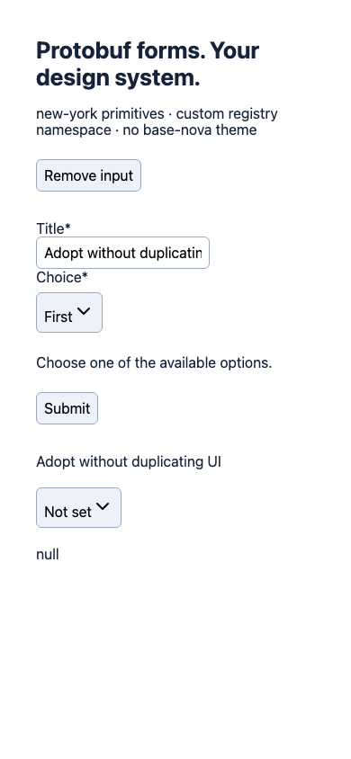
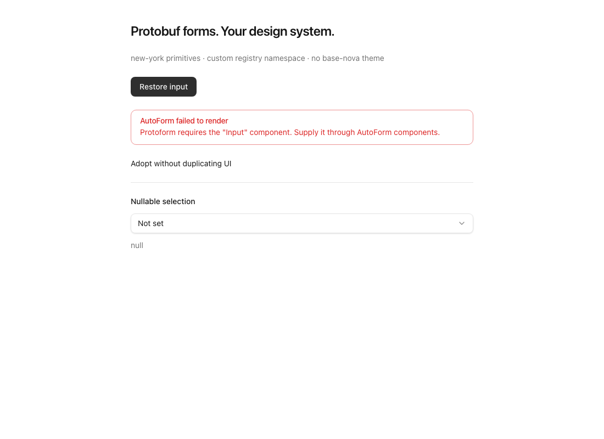
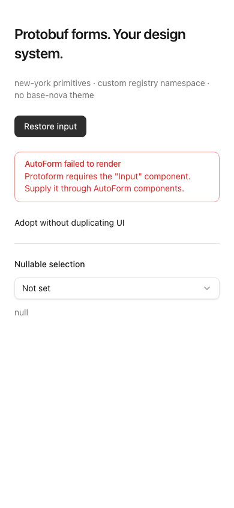

# Host-owned registry verification

## Reproduce

```bash
bun install --frozen-lockfile
bun run registry:build
bun run registry:consumer-smoke
bun run registry:host-browser
```

The consumer smoke uses the repository's locked shadcn CLI. It creates disposable fixtures under
`.tmp/` and requires network access for the host registry and npm dependencies. Run it serially:
the fixtures and local registry port are shared. `--host-only` skips the older bundles when iterating.

The host fixture uses `new-york`, an independently configured `@host` registry namespace, and
separate nested aliases for UI, components, hooks, and library files. Before installing Protoform,
it records the contents of the existing UI SDK control files, the host stylesheet, utilities, and
`components.json`. After installation it verifies byte equality and that no extra primitives appeared.
It then typechecks and server-renders the installed AutoForm, not repository source aliases.
The other fixtures typecheck core-only and themed UI SDK installs, including the experimental form engines.

## Browser coverage

Chromium at 1100×800 and 390×844:

- Computed host theme color and full-width input: fail if CSS is missing.
- Required select placeholder and selection.
- Submit through the host's input and button.
- Remove a required UI mapping; show the missing component by name.
- Restore the mapping with the same schema; recover without remounting the entire app.
- Empty submission, visible validation feedback, correction, and successful resubmission.
- Distinguish an unset selection from the literal string `"null"`.
- No uncaught browser errors. React's development error-boundary report during the intentional
  missing-component step is expected.

| Desktop                                                                                                     | Mobile                                                                                                               |
| ----------------------------------------------------------------------------------------------------------- | -------------------------------------------------------------------------------------------------------------------- |
|                |                |
|  |  |

These are new-host-entrypoint baselines, not screenshots of a redesigned legacy form. The fixture's
Tailwind v4 stylesheet and neutral theme are consumer-owned and are not shipped by Protoform.
The Vite Tailwind plugin compiles both installed primitives and Protoform classes; the browser imports
the stylesheet. The original handwritten-CSS snapshots were inadequate styling evidence and are replaced.

## Scope and limitations

The host adapter maps the renderer-neutral form boundary to host-owned UI SDK controls. Other
component libraries need their own map. All form engines use the same updated boundary; hook-only
and core-only installations stay independent of UI SDK. Specialized combobox, multi-select,
choicebox, JSON, and key/value controls still require explicit host mappings or custom renderers.

The `@host` namespace resolves the pinned local registry snapshot, not a moving third-party registry.
Installing the core and host adapter must not mutate the already-installed controls or host theme.
Previous screenshot baselines must be reviewed against the current native UI SDK composition.

## Agent and core behavior verification

The installed `ui-sdk-agent-workbench` example runs at `/agent.html` in the full consumer fixture. `scripts/agent-consumer.browser.spec.ts` covers explicit enablement, snapshot/query/act, controlled callback cancellation, custom primitive actions, secret/hidden marks, human approval and rejection, actual AutoForm validation/submission, asynchronous source propagation, staging/revert, seek/replay, source-specific undo, and repeated session disposal. A browser-provided WebMCP registration spy must remain untouched. `e2e/agent-workbench.spec.ts` separately exercises the built Blume example at 1280px, 390px, and 320px in light/dark modes: the docs preview's intrinsic sizing must not widen the page, even after long snapshot output, and approval controls must remain in the viewport.

`registry/base-nova/protoform/components/rating/rating.browser.test.tsx` exercises the framework-free primitive with SDK `mount`, `checkPattern`, `checkServer`, and `checkDirection`, including strict SDK warnings, keyboard selection, announcements, argument bounds, and cancellation. `lib/ui-sdk/session.browser.test.tsx` tests the application's policy/lifecycle seam, not a reimplementation of SDK internals. UI history does not undo submitted side effects.
